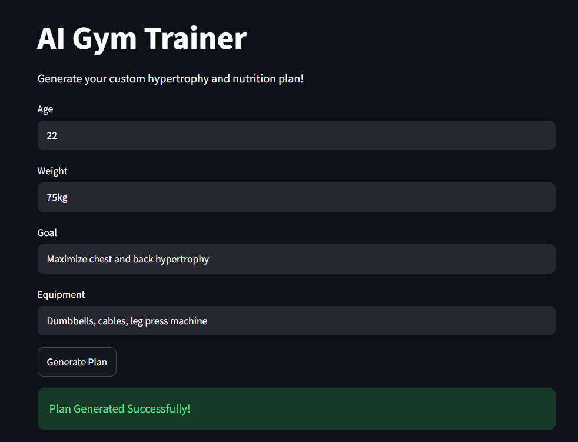

# 🚀 [Tips Hindawi](https://www.tipshindawi.com/) Internship (August–October) 2026

> 🎓 This project was built during the [ **Tips Hindawi** ](https://www.tipshindawi.com/) **Internship (August–October) 2026**.

## 👤 Participant

| Field            | Value                                |
| ---------------- | ------------------------------------ |
| Full Name        | Mina Ashraf Zaky Marid Garas         |
| Project Name     | AI Gym Coach                         |
| GitHub Username  | mina-ashraf                          |
| Internship Batch | August–October 2026                  |
| Training Program | Large Language Models (LLMs) Program |
| Organization     | [**Edrak for Ai**](https://edrak4ai.com/en)                         |

---

# 📖 Project Overview

A Retrieval-Augmented Generation (RAG) AI Gym Trainer that generates customized hypertrophy workout routines and nutrition plans based on user demographics and equipment. The backend is deployed on Kaggle using a FAISS vector database and a 4-bit quantized Mistral-Nemo-Instruct-2407 Large Language Model (a 12-billion parameter model) exposed via FastAPI and ngrok, with a local interactive Streamlit frontend.

---

# ✨ Features

* Feature 1: Personalized hypertrophy and nutrition plan generation based on user age, weight, goal, and available equipment.
* Feature 2: Scientific grounding using a FAISS vector database loaded with open-source academic guidelines and comprehensive exercise datasets.
* Feature 3: Strict JSON output parsing via LangChain for seamless integration with an interactive local Streamlit dashboard.

---

# 🛠️ Technologies Used

Large Language Model: Mistral-Nemo-Instruct-2407 (4-bit quantized)

Frameworks & Libraries: LangChain, FastAPI, Streamlit, PyTorch, Transformers, BitsAndBytes

Vector Database & Embeddings: FAISS, Hugging Face all-MiniLM-L6-v2

Networking: pyngrok, Uvicorn

---

# ⚙️ Installation

Backend (Kaggle): Upload the academic PDFs and exercises.json as a Kaggle dataset. Run the ai-gym-coach.ipynb notebook on a Kaggle T4 GPU to initialize the FAISS database, load the quantized LLM, and expose the FastAPI endpoint via ngrok.

Frontend (Local):

Clone the repository.

Install dependencies: pip install streamlit requests

Update the URL variable in app.py with the live ngrok URL generated by the Kaggle backend.

---

# 🚀 Usage

Run streamlit run app.py in your local PowerShell terminal. Enter your Age, Weight, Goal, and Equipment in the Streamlit UI, and click "Generate Plan" to receive a strictly formatted workout and nutrition regimen.

---

# 📸 Demo

---

# 📈 Results

Successfully implemented a functional RAG pipeline using a 12-billion parameter LLM compressed via 4-bit quantization on a single T4 GPU. Bridged a cloud-based inference engine with a local UI using secure ngrok tunneling and FastAPI.

---

# 🔮 Future Improvements

* Improvement 1: Integrate a user authentication system to save and track workout progress over time.
* Improvement 2: Expand the FAISS knowledge base with more specialized nutrition protocols and mobility routines.
* Improvement 3: Migrate the backend from Kaggle to a dedicated cloud hosting platform for 24/7 API uptime.

---

# 📚 About the Internship

This project was developed as part of the [**Tips Hindawi**](https://www.tipshindawi.com/) **Internship (August–October) 2026**, and it will be showcased on the official [Tips Hindawi](https://www.tipshindawi.com/) website.

[Tips Hindawi](https://www.tipshindawi.com/) is the internships department of [**Edrak for Ai**](https://edrak4ai.com/en), and the internship encourages participants to build real-world projects, apply practical skills, and showcase their work through GitHub.

For more information about the internship, training programs, and upcoming batches, visit the official [Tips Hindawi](https://www.tipshindawi.com/) website.

---

# 📄 License

This project is shared for educational and portfolio purposes.
